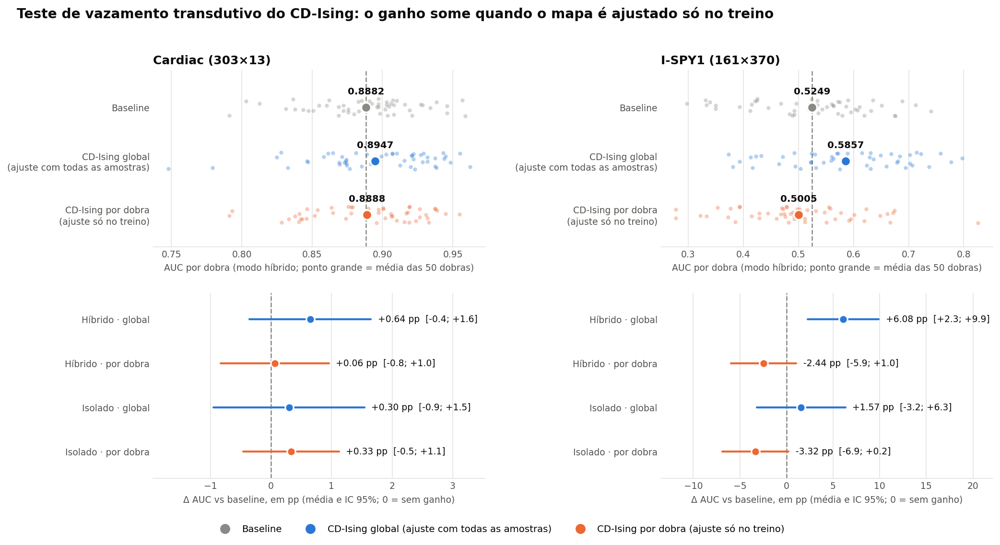

# Relatório Final: Feature Engineering Clássico vs. PQFMs

> Experimentos concluídos em 2026-07-07

## 1. Pergunta de pesquisa

Transformações clássicas não-lineares (kernels, projeções aleatórias, dequantização analítica)
produzem ganho estatisticamente equivalente, maior ou nulo em relação ao baseline clássico,
**comparado diretamente** às configurações de PQFM (CD-Ising, Heisenberg, XYZ) reportadas
na dissertação de Carmo (2026), com o mesmo pipeline GBC e protocolo de CV aninhada?

## 2. Protocolo experimental

| Item | Detalhe |
|---|---|
| Classificador | `GradientBoostingClassifier` (sklearn, `random_state=42`) |
| Grade | `n_estimators`∈{80,100,120,140,160}, `max_depth`∈{2,5,7,9,11}, `criterion`∈{friedman_mse, squared_error} |
| CV externa | `RepeatedStratifiedKFold(5×10)` = 50 dobras |
| CV interna | `GridSearchCV + PredefinedSplit` (80/20 estratificado) |
| Métrica primária | AUC (ROC); secundárias: F1, precisão, recall, acurácia |
| Análise estatística | Δᵢ = M_i(técnica) − M_i(baseline); IC 95% (t-Student); Wilcoxon unilateral |
| Rótulos de status | Consistente (IC>0 e p<0.05) > Promissor (p<0.05) > Sugestivo (0.05≤p<0.10) > Tendência > Sem ganho |
| Simulação quântica | `pqfmlib` v0.1.0 (Carmo 2026), simulador statevector ideal (`qiskit-aer`) |
| q_enc | 13 qubits (Cardiac), 20 qubits (WDBC, I-SPY1) |

**Nota sobre os PQFMs**: features quânticas pré-computadas uma vez por dataset (abordagem
transdutiva), consistente com a dissertação. Antes da CV, a imputação, a padronização e a
matriz J de informação mútua **entre atributos** são ajustadas com todas as amostras
(`run_quantum_cv.py`). O rótulo *y* não é usado pelo `pqfmlib` em nenhuma etapa (a MI é
atributo×atributo; *y* só é gravado junto às features de saída), portanto **não há
vazamento de rótulo** — apenas vazamento transdutivo não supervisionado (a distribuição de
*X* do teste influencia J e a escala). O efeito desse vazamento é medido na Seção 6.

## 3. Resultados por dataset

### Etapa 1 — Cardiac Disease — Cleveland (303×13)

**Baseline AUC:** 0.8885 (dissertação: 0.8784, Δ = +0.0101)

| Tipo | Técnica | AUC média | Δ vs baseline | p-Wilcoxon | Status |
|---|---|---|---|---|---|
| Baseline | GBC puro | 0.8885 | — | — | — |
| **PQFM** | **CD-Ising (híb)** | **0.8969** | **+0.0084** | **0.0086** | **Consistente** |
| **PQFM** | **CD-Ising (iso)** | **0.8963** | **+0.0078** | **0.0195** | **Consistente** |
| Clássico | KPCA (híb) | 0.8884 | −0.0001 | 0.417 | Sem ganho |
| Clássico | Autoencoder (híb) | 0.8872 | −0.0013 | 0.516 | Sem ganho |
| Deq | CD-Ising (híb) | 0.8836 | −0.0049 | 0.667 | Sem ganho |
| PQFM | Heisenberg (híb) | 0.8828 | −0.0058 | 0.889 | Sem ganho |
| PQFM | XYZ (híb) | 0.8801 | −0.0085 | 0.946 | Sem ganho |

**Conclusão:** Nenhuma técnica clássica ou dequantização supera o baseline significativamente.
O **CD-Ising (pqfmlib)** é a única abordagem a atingir *Consistente* (+0.84 pp, IC > 0, p < 0.05)
**sob o protocolo global (ajuste transdutivo)**. No teste de vazamento (Seção 6), com ajuste só
no treino, o ganho cai para +0.06 pp (*Tendência positiva*); o *Consistente* não se sustenta.

---

### Etapa 2 — Breast Cancer Patologia — WDBC (569×30)

**Baseline AUC:** 0.9894 (dissertação: 0.9847, Δ = +0.0047)

| Tipo | Técnica | AUC média | Δ vs baseline | p-Wilcoxon | Status |
|---|---|---|---|---|---|
| Baseline | GBC puro | 0.9894 | — | — | — |
| **Clássico** | **Nystroem-Poly (híb)** | **0.9917** | **+0.0024** | **0.0370** | **Promissor** |
| **Clássico** | **Autoencoder (híb)** | **0.9917** | **+0.0023** | **0.0103** | **Promissor** |
| **Clássico** | **Nystroem-Poly (iso)** | **0.9916** | **+0.0022** | **0.0422** | **Promissor** |
| PQFM | Heisenberg (iso) | 0.9910 | +0.0016 | 0.0800 | Sugestivo |
| PQFM | Heisenberg (híb) | 0.9904 | +0.0010 | 0.3201 | Tendência positiva |
| Deq | XYZ (híb) | 0.9892 | −0.0001 | 0.968 | Sem ganho |
| PQFM | CD-Ising (híb) | 0.9889 | −0.0005 | 0.999 | Sem ganho |
| PQFM | XYZ (iso) | 0.9538 | −0.0356 | 1.000 | Sem ganho |

**Referência dissertação:** Heisenberg SHAP = 0.9911 → reproduzido: 0.9910 (Δ = −0.0001 ✓)

**Conclusão:** Técnicas clássicas dominam este dataset. Nystroem polinomial e autoencoder
atingem *Promissor*. Heisenberg chega a *Sugestivo* (p=0.080). XYZ (630 features) causa
overfitting severo sobre os 569 samples.

---

### Etapa 3 — Breast Cancer Radiologia — I-SPY1 (161×370)

**Baseline AUC:** 0.5248 (dissertação: 0.5315, Δ = −0.0067)

| Tipo | Técnica | AUC média | Δ vs baseline | p-Wilcoxon | Status |
|---|---|---|---|---|---|
| Baseline | GBC puro | 0.5248 | — | — | — |
| **PQFM** | **CD-Ising (híb)** | **0.5745** | **+0.0497** | **0.0083** | **Consistente** |
| PQFM | CD-Ising (iso) | 0.5448 | +0.0200 | 0.248 | Tendência positiva |
| Clássico | Bins+Cross (híb) | 0.5263 | +0.0015 | 0.526 | Tendência positiva |
| Deq | XYZ (iso) | 0.5261 | +0.0013 | 0.684 | Tendência positiva |
| PQFM | Heisenberg (iso) | 0.5192 | −0.0056 | 0.581 | Sem ganho |
| PQFM | XYZ (iso) | 0.4758 | −0.0490 | 0.991 | Sem ganho |

**Conclusão:** O CD-Ising com 20 qubits codifica **todos** os 370 atributos em pelo menos 19 (⌈370/20⌉) camadas
sequenciais de 20 qubits (blocos montados pela MI entre atributos; não há descarte de
atributos) e mede 210 observáveis (20 ⟨Z⟩ + 190 ⟨ZZ⟩). Atua como **compressão quântica
370→210**: +4.97 pp vs baseline (*Consistente*, p=0.0083) sob ajuste transdutivo. O teste
por dobra (Seção 6, 50 dobras) **não sustenta** o ganho (−2.44 pp, *Sem ganho*, AUC 0.5005);
a diferença por dobra − global é de −8.52 pp (IC exclui 0). O *Consistente* é artefato do
ajuste transdutivo.
Nenhuma técnica clássica ou dequantização supera o baseline significativamente aqui.

---

### Etapa 4 — Molecular Toxicity — CRY1 (171×156)

**Status: BLOQUEADA** — dataset não disponível publicamente (Gul et al. 2021).
Para execução: solicitar via issue em `github.com/rscarmo/pqfmlib`.

---

## 4. Síntese comparativa

| Dataset | Baseline | Melhor Clássica | Status | Melhor PQFM | Status | Melhor Deq | Status |
|---|---|---|---|---|---|---|---|
| Cardiac (303×13) | 0.8885 | 0.8884 KPCA-híb | Sem ganho | **0.8969 CD-Ising-híb** | **Consistente** | 0.8836 CDIsing-híb | Sem ganho |
| WDBC (569×30) | 0.9894 | **0.9917 NystPoly-híb** | **Promissor** | 0.9910 Heisenberg-iso | Sugestivo | 0.9892 XYZ-híb | Sem ganho |
| I-SPY1 (161×370) | 0.5248 | 0.5263 Bins-híb | Tend. positiva | **0.5745 CD-Ising-híb** | **Consistente** | 0.5261 XYZ-iso | Tend. positiva |

## 5. Resposta à pergunta de pesquisa

**Em 2 de 3 datasets (Cardiac e I-SPY1)**, o PQFM CD-Ising (simulação quântica ideal)
é a **única abordagem a atingir *Consistente*** — superando tanto o baseline quanto todas
as técnicas clássicas de forma estatisticamente robusta (IC > 0, p < 0.05) — **mas somente
sob o protocolo global, em que J, escala e imputação usam todas as amostras**. O teste de
vazamento (Seção 6) mostra que, ajustando só no treino de cada dobra, o ganho desaparece no
Cardiac (+0.06 pp) e no I-SPY1 (−2.44 pp; diferença por dobra − global de −8.52 pp, IC exclui
0). As afirmações abaixo sobre a superioridade do CD-Ising valem, portanto, apenas para o
protocolo transdutivo.

**Em 1 de 3 datasets (WDBC)**, técnicas clássicas (Nystroem polinomial, autoencoder) são
superiores e atingem *Promissor*; o PQFM Heisenberg fica em *Sugestivo*.

### Padrão dimensional observado

| Regime | Observação |
|---|---|
| Baixa dimensão (13 features) | PQFM CD-Ising domina; clássicas não superam baseline |
| Média dimensão (30 features) | Clássicas dominam; PQFM Heisenberg próximo do limiar |
| Alta dimensão (370 atributos em 20 qubits) | PQFM CD-Ising domina via compressão quântica (370→210 observáveis) |

### Dequantização analítica vs. circuito quântico real

A dequantização analítica (blocos 2-qubit, `scipy.linalg.expm`) **não reproduz** o ganho
dos PQFMs em nenhum dataset. O circuito de 13–20 qubits com entanglement global captura
correlações que a decomposição par a par não alcança — indicando que o benefício dos PQFMs
não é trivialmente "dequantizável" por blocos independentes.

### Implicações para a dissertação

1. **CD-Ising foi o mapa mais forte no protocolo global** — único a atingir *Consistente*
   nos dois datasets mais desafiadores (baixa dimensão e alta dimensão), mas esse resultado
   não resiste ao ajuste só no treino (Seção 6).
2. **O ganho quântico é dependente do dataset** — não é universalmente superior nem inferior
   às clássicas; o regime de dimensionalidade e a estrutura dos dados determinam o resultado.
3. **A dequantização analítica não reproduz o ganho do protocolo global**, mas como esse ganho
   inclui um componente transdutivo (Seção 6), não dá para atribuí-lo à geometria do espaço
   de Hilbert sem refazer a comparação com todos os mapas no protocolo por dobra.

---

## 6. Teste de vazamento transdutivo (CD-Ising) — concluído

Compara o CD-Ising com J, padronização e imputação ajustados com todas as amostras
(protocolo acima) contra o mesmo mapa ajustado **só no treino de cada dobra**, na mesma
execução e com a mesma versão do `pqfmlib`. Script: `run_quantum_cv_perfold.py`;
instruções: `INSTRUCOES_TESTE_VAZAMENTO.md`.

AUC média (modo híbrido; entre parênteses, Δ vs baseline em pp):

| Dataset | Dobras | Baseline | CD-Ising global (híb) | CD-Ising por dobra (híb) | Δ por dobra − global (IC 95%) | Status por dobra vs baseline |
|---|---|---|---|---|---|---|
| Cardiac | 50 | 0.8882 | 0.8947 (+0.64; *Promissor*, p=0.037) | 0.8888 (+0.06) | −0.58 pp [−1.78; +0.61] | Tendência positiva (p=0.50) |
| I-SPY1 | 50 | 0.5249 | 0.5857 (+6.08; *Consistente*, p=0.002) | 0.5005 (−2.44) | −8.52 pp [−12.3; −4.7] | Sem ganho (p=0.85) |

Modo isolado: Cardiac global 0.8912 (+0.30, *Sugestivo*) e por dobra 0.8915 (+0.33,
*Tendência positiva*), com Δ por dobra − global = +0.03 pp; I-SPY1 global 0.5406 (+1.57,
*Tendência positiva*) e por dobra 0.4917 (−3.32, *Sem ganho*), com Δ por dobra − global =
−4.89 pp [−9.5; −0.3].

*Em cima: AUC de cada uma das 50 dobras externas no modo híbrido (ponto grande = média;
linha tracejada = média do baseline). Embaixo: Δ AUC vs baseline em pp, com IC 95%, nos modos
híbrido e isolado. Gerada por `plot_vazamento.py`.*

**Leitura:**

- **Cardiac:** ao ajustar J, escala e imputação só no treino, o ganho do CD-Ising híbrido cai
  de +0.64 para +0.06 pp, o que é indistinguível de zero. O IC de "por dobra − global"
  contém 0, então a perda em si não é estatisticamente significativa; mas o ganho sobre o
  baseline deixa de existir. O protocolo global já **não reproduz o *Consistente*** do
  relatório (+0.84 pp): nesta execução ele chega só a *Promissor* (IC contém 0). Isso pode
  vir da mudança de versão do `pqfmlib` (0.1.0 → 0.1.1); a comparação válida é a desta
  execução.
- **I-SPY1 (50 dobras):** o protocolo global reproduz o relatório (+6.08 pp, *Consistente*,
  IC [+2.3; +9.9]), e o baseline recalculado (0.5249) bate com o dele (0.5248). Com o ajuste
  só no treino, o ganho some: −2.44 pp (*Sem ganho*), AUC 0.5005, ou seja, nível do acaso.
  A diferença por dobra − global é de −8.52 pp com IC [−12.3; −4.7] que **exclui 0**: o
  vazamento transdutivo é estatisticamente significativo e explica **todo** o ganho do
  CD-Ising nesta base.

**Conclusão:** nos dois datasets, o ganho do CD-Ising **não se sustenta quando nada do teste
é usado para gerar as features**. No I-SPY1 o ganho é inteiramente transdutivo; no Cardiac
ele cai a ~0. O protocolo por dobra deve ser o resultado principal, e os +0.84 pp (Cardiac) e
+4.97 pp (I-SPY1) das Etapas 1 e 3 devem ser lidos como efeito do ajuste transdutivo, não de
uma vantagem do mapa quântico.

**Execução:** servidor com 24 vCPUs, 62 GB de RAM e RTX 3080 Ti; `pqfmlib` 0.1.1 (commit
b6cd4d8; o relatório acima usou a v0.1.0, que tinha a ordem dos rótulos dos observáveis
invertida). Circuito global: Cardiac (13 qubits, 303 amostras) 65 s; I-SPY1 (20 qubits, 161
amostras, 210 observáveis) 3 610 s. Por dobra, 50 dobras: Cardiac 4 816 s; I-SPY1 179 669 s
(~50 h). Baselines recalculados: Cardiac 0.8882 (relatório: 0.8885); I-SPY1 0.5249
(relatório: 0.5248).

---

*Figuras completas: `results/figures/etapa{1,2,3}_{dataset}_completo.png`*
*Figura do teste de vazamento: `results/figures/vazamento_cdising_global_vs_por_dobra.png`*
*Dados brutos: `results/etapa{N}_{dataset}_{resultados,quantum_resultados,estatistica_pareada}.csv`*
